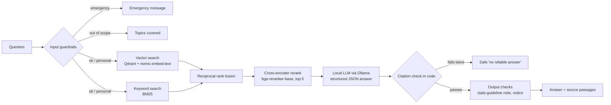

# Clinical Guidelines RAG Assistant

A free, fully local assistant that answers questions from public NICE clinical guidelines and
**always shows the exact passage it used**. Nothing is sent to an outside service: the language
model and the embedding model run on your own computer through [Ollama](https://ollama.com).

> **Not a medical device.** This is a learning project. It summarizes public guidelines and does
> not replace advice from a qualified healthcare professional.

## 1. What it does, and why grounding and citations matter

Language models write fluent text even when they are wrong. In healthcare, a confident wrong
answer can hurt someone. This project reduces that risk in four ways:

1. **Retrieval-Augmented Generation (RAG):** the model may only use passages retrieved from the
   guidelines, not what it "remembers".
2. **Citations checked in code:** the model must cite passage ids and quote them. Plain Python then
   checks that every cited id was really retrieved and every quote really appears in the cited text.
   If the check fails twice, the assistant says it could not find a reliable answer.
3. **Guardrails:** possible emergencies get an "contact emergency services" message instead of an
   answer, questions about your own treatment are labelled as general information, and unrelated
   questions are declined.
4. **Evaluation:** the system is measured, not trusted (see section 5).

The guidelines covered: NG106 (chronic heart failure), NG28 (type 2 diabetes), NG115 (COPD) and
NG136 (hypertension).

## 2. How it works



| Step | File |
|---|---|
| Download and parse NICE pages | `src/guideline_rag/ingest.py` |
| Structure-aware chunks (one recommendation = one chunk, tables kept whole) | `src/guideline_rag/chunking.py` |
| Vector (Qdrant, local) and BM25 indexes | `src/guideline_rag/index.py` |
| Hybrid search, fusion, reranking | `src/guideline_rag/retrieval.py` |
| Grounded answer and citation verification | `src/guideline_rag/generation.py` |
| Input and output safety checks | `src/guideline_rag/guardrails.py`, `guardrails.yaml` |
| Whole flow in one function | `src/guideline_rag/pipeline.py` |
| API / web interface | `src/guideline_rag/api.py`, `app/streamlit_app.py` |
| Evaluation | `eval/` |

## 3. Install and run from scratch

These steps are for Windows; on macOS or Linux, use the equivalent commands.

1. **Python 3.11 or newer** from python.org.
2. **Ollama** from ollama.com (or `winget install Ollama.Ollama`). Then pull the models.
   `qwen2.5:7b` needs about 16 GB of RAM; on a smaller machine use `qwen2.5:3b` and change
   `models.llm` in `config.yaml`.
   ```bash
   ollama pull qwen2.5:7b
   ollama pull nomic-embed-text
   ```
3. **Project environment:**
   ```bash
   python -m venv .venv
   .venv\Scripts\activate
   pip install -e .
   ```
4. **Download, parse and chunk the guidelines** (polite: robots.txt checked, 2 s delay, cached):
   ```bash
   python -m guideline_rag.ingest
   python -m guideline_rag.chunking
   ```
5. **Build the indexes** (the first reranker use downloads about 1 GB from Hugging Face, once):
   ```bash
   python -m guideline_rag.index --rebuild
   ```
6. **Start everything** and open http://localhost:8501:
   ```bash
   python start.py
   ```
7. **Run the tests:** `python -m pytest`

### Windows note: certificate error on import

If `import deepeval` or `import phoenix` fails with `SSLError ... nested asn1 error`, one
certificate in your Windows certificate store is malformed. `guideline_rag/__init__.py` contains a
small, safe workaround (it skips only the broken certificate). Import `guideline_rag` first in your
own scripts, as the ones in this repository do.

### Optional: tracing with Arize Phoenix (local)

```bash
python -m phoenix.server.main serve          # terminal 1, UI at http://localhost:6006
$env:GUIDELINE_TRACING = "1"; python start.py   # terminal 2 (PowerShell)
```

Each question then shows up as a trace with the steps guardrails, retrieval, generation and output checks.

## 4. Add a new guideline

1. Open `data/sources.yaml` and add an entry under `guidelines`, for example
   `- code: NG222` with a `topic:`. The code is the one in the NICE URL
   (`https://www.nice.org.uk/guidance/ng222`).
2. Run `python -m guideline_rag.ingest`, `python -m guideline_rag.chunking`,
   `python -m guideline_rag.index --rebuild`.
3. Add the guideline code to the dropdown in `app/streamlit_app.py`, and its topic words to
   `guardrails.yaml` (`scope_topics` and `scope_keywords`) so questions about it are not called
   out of scope.

The downloader reads each guideline's chapter menu, so it copes with NICE's two layouts (one big
"Recommendations" chapter, or many chapters as in NG28).

## 5. Evaluation

RESULTS_PLACEHOLDER

## 6. Known limitations

- It uses a **small local model** (7 billion parameters). It can miss the best passage, write a
  thin answer, or decline when the answer is present. Always read the cited passage.
- It covers **only four guidelines**, and only their recommendation chapters (not the full evidence
  review). NG115 was last updated in 2019 and the app warns about this.
- The **test set was drafted by the same kind of model** and must be reviewed by a human. Each
  question has one expected source passage, although other passages may also answer it, so retrieval
  scores are conservative.
- Guardrails are keyword and small-model based. They will miss some emergencies and wrongly flag
  some harmless questions. They are a safety net, not a clinical triage system.
- **This is not a medical device** and must not be used for patient care.

## 7. Free deployment options (honest version)

- **Local (what this project does):** runs fully on your own computer at no cost, and no question
  leaves it. This is the recommended way.
- **Free cloud hosting is limited.** Free tiers usually have no GPU and too little memory to run a
  7B language model, so the complete app cannot simply be hosted for free. Two partial options
  (not set up here):
  1. Host **only the Streamlit interface** in the cloud while the API and model keep running on your
     computer (reachable through a tunnel). The model stays local, but your computer must be on.
  2. Use a **hosted model with a free tier**. That would work in the cloud, but **questions would
     leave your computer**, which this project deliberately avoids, and free tiers have limits.

## Note on the source content

Guideline text is published by NICE (the UK National Institute for Health and Care Excellence). It is
used here for a **personal, non-commercial educational project**. Anyone reusing this project or its
data should check [NICE's reuse terms](https://www.nice.org.uk/re-using-our-content) first.
Downloads respect `robots.txt`, use a descriptive User-Agent, wait at least 2 seconds between
requests, and are cached locally so each page is fetched only once.
